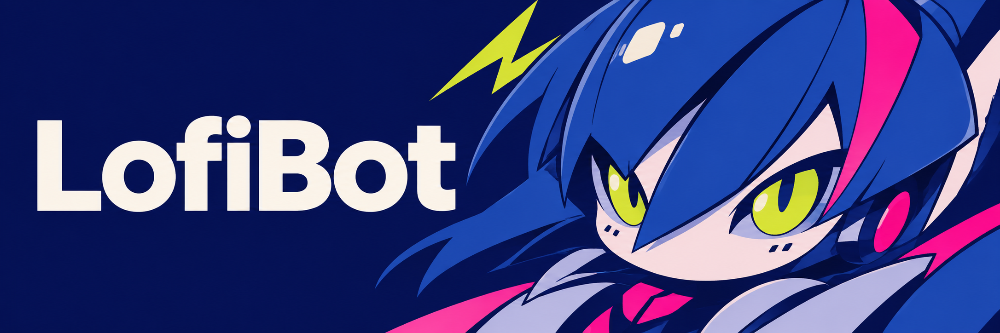
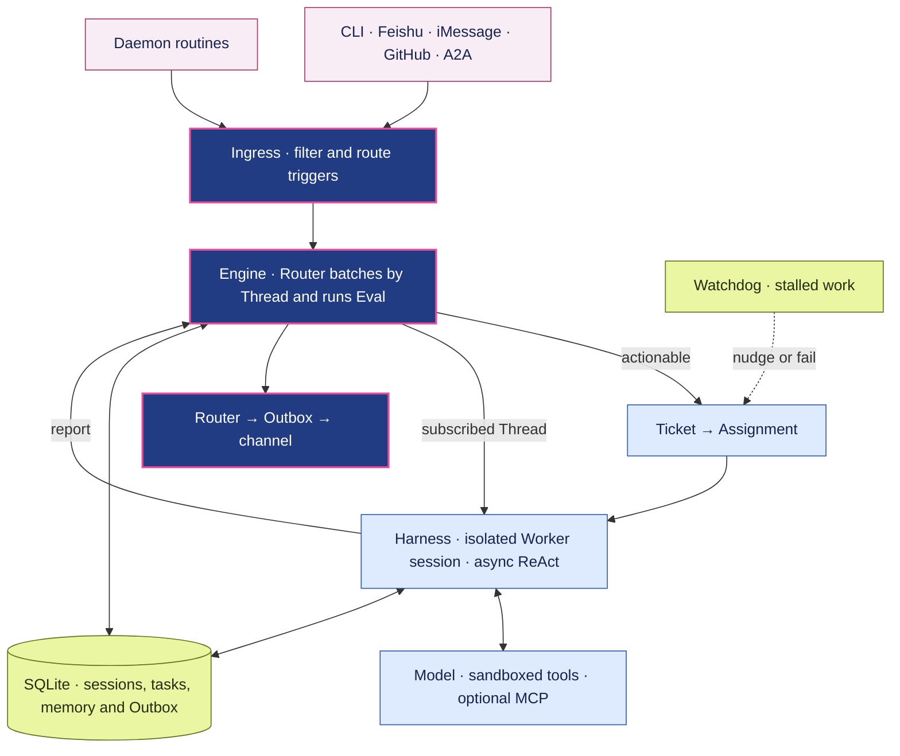

# LofiBot

English · [简体中文](README.zh-CN.md)

LofiBot is a local TypeScript agent that turns messages and scheduled events into tasks. Its Router keeps the conversation moving while Workers run tasks in separate sessions. SQLite keeps task state across restarts.

## Quick start

Requires Node.js 22+, pnpm, and a model API key.

```bash
git clone https://github.com/LofiSu/LofiBot.git
cd LofiBot
pnpm install
export DEEPSEEK_API_KEY=your-key
pnpm lofibot init
pnpm lofibot chat "Summarize the open tickets"
pnpm lofibot tasks
```

See [installation](docs/install.md) for other providers or to migrate an existing checkout. For Feishu and iMessage, run `pnpm lofibot channels check` before `pnpm lofibot serve --imessage --feishu`. See [channel setup](docs/REAL_CHANNELS.md) for details and GitHub.

For a native chat window, see the [Rune desktop client](desktop/README.md). It connects to the same Agent runtime and can render an offline preview without opening a window.

## Architecture



The Router owns replies. Workers report their results to it, and the Outbox handles delivery. Scheduled triggers and channel messages share the same ingress path.

[Architecture](docs/architecture.md) · [Module reference](docs/MODULES.md) · [Safety](docs/safety.md) · [MIT license](LICENSE)
