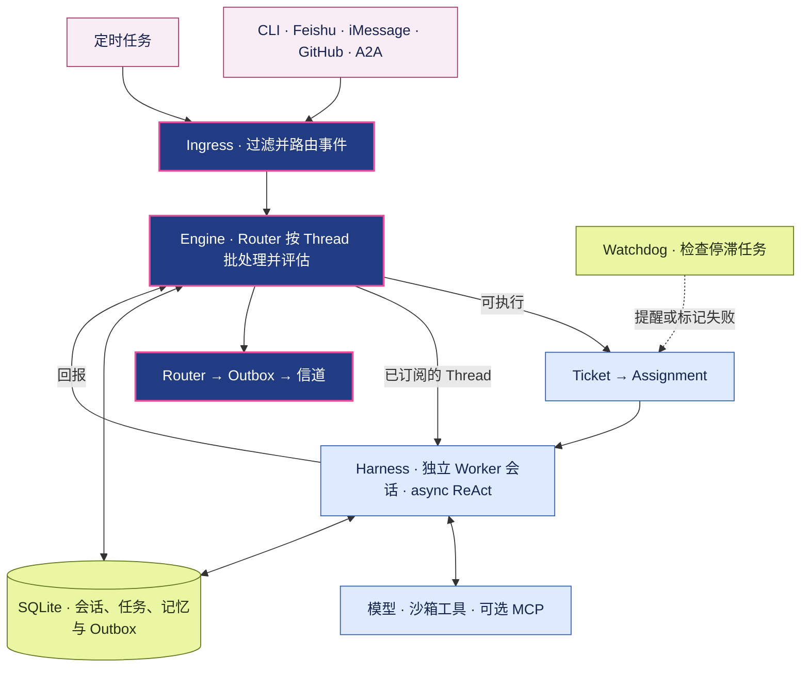

# LofiBot

[English](README.md) · 简体中文

LofiBot 是一个本地运行的 TypeScript 智能助手，把消息和定时事件转成任务。Router 保持对话畅通，Worker 在独立会话中执行任务。任务状态保存在 SQLite 中，重启后可继续使用。

## 快速开始

需要 Node.js 22+、pnpm 和模型 API 密钥。

```bash
git clone https://github.com/LofiSu/LofiBot.git
cd LofiBot
pnpm install
export DEEPSEEK_API_KEY=your-key
pnpm lofibot init
pnpm lofibot chat "总结当前未关闭的任务"
pnpm lofibot tasks
```

更换模型服务商或迁移已有安装，请看[安装指南](docs/zh/install.md)。同时启用飞书和 iMessage 时，先运行 `pnpm lofibot channels check`，再运行 `pnpm lofibot serve --imessage --feishu`。详细配置和 GitHub 接入见[信道文档](docs/REAL_CHANNELS.md)。

## 架构



Router 负责回复，Worker 向它回报执行结果，由 Outbox 负责投递。定时事件和信道消息共用同一条入口链路。

[架构说明](docs/zh/architecture.md) · [模块参考](docs/MODULES.md) · [安全说明](docs/zh/safety.md) · [MIT 许可证](LICENSE)
