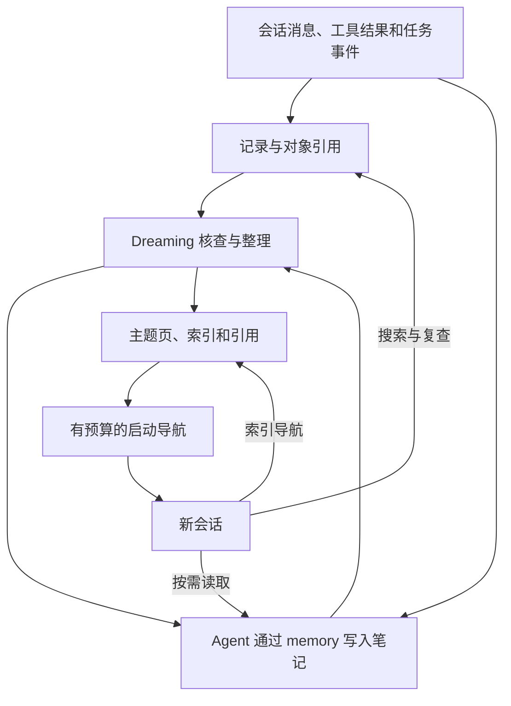

# Anthropic 的 Agent Memory 及其在 lofibot 中的落地

Anthropic 的工程文章给出了跨会话记忆的结构与评估。Claude Platform 文档定义了模型如何请求应用读写记忆。前者回答信息应如何组织、校验与复用，后者回答应用应怎样执行一次具体操作。本文先解释两份资料，再把它们映射到 lofibot 的 M6 Memory 和现有执行链路。[Agent memory 研究文章](https://www.anthropic.com/research/components-of-agent-memory) · [Memory tool 接口](https://platform.claude.com/docs/en/agents-and-tools/tool-use/memory-tool)

## 1. 四层记忆与两条写入路径

| 层 | 保存的内容 | 读取时机 | 维护职责 |
| --- | --- | --- | --- |
| Transcripts | 会话消息、工具结果、评估与事件 | 需要还原经过或核查事实时 | 宿主记录、索引并执行保留策略 |
| Memory notes | 用户偏好、任务检查点、验证过的规则、待查假设 | 当前任务命中相关主题时 | Agent 在当场记录，整理任务随后更正或归并 |
| Memory representations | 关联主题页、Wiki、导航和索引 | 跨多段记录综合信息时 | 整理任务构建，维护指向原始材料的引用 |
| Injected context | 体积受限的高价值提示及下层入口 | 会话或任务初始化时 | 宿主按预算装载，整理任务负责筛选与降级 |

这里的记忆是跨会话保留、以后可以重新读取的经验。Compaction 压缩较早的上下文，帮助同一执行过程继续。会话记录则给后续过程保留复查依据，笔记与索引保存未来可能用到的结论或入口。[研究文章的记忆层次](https://www.anthropic.com/research/components-of-agent-memory#memory-notes) · [Memory tool 与 compaction](https://platform.claude.com/docs/en/agents-and-tools/tool-use/memory-tool#using-with-compaction)

**在线路径。** 任务执行期间保存已形成的决策、明确要求记住的偏好或具有后续价值的检查点。以“下次从迁移验证继续”为例，笔记可以写当前检查点、证据入口和下一条检查命令。每次运行产生的完整输出保留在记录层，需要时再追溯。把规则与适用范围、证据和当前验证状态一起保存，能让下个会话知道何时可以直接使用，何时需要复核。

**整理路径。** Anthropic 称离开任务主路径后回读、核查和重组记忆的过程为 dreaming。它能把记录中的相互矛盾之处与相关笔记对照，修订结论，补全失效链接，构建主题索引，也能把稳定、频繁有用的条目提升到会话入口。原始记录表明某条消息曾经出现，记录中的断言仍需按其出处与验证情况判断。[Dreaming 的纠错示例](https://www.anthropic.com/research/components-of-agent-memory#dreaming-can-correct-memory) · [Dreaming 如何构建表示](https://www.anthropic.com/research/components-of-agent-memory#dreaming-can-build-new-memory-representations)

**读取路径。** 初始化时载入简短导航。需要了解某个主题时读取相关笔记。涉及精确事实、冲突或引用时，沿着引用进入原始记录。对事实变化频繁的系统，当前工具查询通常是判断现状的直接证据。既有笔记仍可用于找出应查询的对象、命令和历史决策背景。

## 2. 研究结果及其工程含义

- CL-Bench 1.0 的数据库任务给每道题开启一个新的会话，并让目录跨题保留。Opus 5 的平均奖励从 0.564 到 0.828，Sonnet 4.6 从 0.330 到 0.364。两组提升的差距说明工具接口之外，模型如何找回笔记、验证假设和修订规则也需要单独测量。[CL-Bench 实验](https://www.anthropic.com/research/components-of-agent-memory#memory-can-be-a-prediction-about-what-the-future-will-need)
- Anthropic 用 Pokémon Red 观察信息筛选。Sonnet 3.7 的一次运行保存了 413 个文件，Fable 5 的一次运行保存了 10 个文件。后者使用顶层短导航和按主题拆分的策略笔记。这项观察给出了设计例子，文件数量本身无法衡量任务效果。[信息筛选实验](https://www.anthropic.com/research/components-of-agent-memory#claude-has-learned-to-judge-salience)
- 在 Stainless 的 25 道语料题中，搜索单独得分 53%，成熟 Wiki 与搜索组合得分 61%。需要在多份资料间综合时，主题页能缩短探索路径。另一项任务的 Wiki 体积超过资料总量，说明要跟踪表示层规模、答案质量和命中成本。[Wiki 实验](https://www.anthropic.com/research/components-of-agent-memory#dreaming-can-build-new-memory-representations)
- 合同实验暴露了并发覆盖及抽象损失。共享页保留了 57 条评分事实中的 41 条，按合同分配写入者并保留原文后能满足全部 57 项标准。lofibot 可以据此采用独立来源页、版本检查和可回查引用，防止两个任务的修改互相覆盖。这是工程推导，原文数据来自 Anthropic 的特定实验。[目标导向的整理](https://www.anthropic.com/research/components-of-agent-memory#dreaming-can-focus-memory-on-a-specific-goal)
- 自动注入带来固定上下文成本和错误传播风险。Claude Code 将入口限制为 `MEMORY.md` 前 200 行或 25 KB，详细内容通过链接访问。lofibot 可以按自己的模型和现有提示预算设置更小的上限，并用相关性、稳定性及可复查性约束晋升。[注入上下文实验与示例](https://www.anthropic.com/research/components-of-agent-memory#dreaming-can-promote-notes-up-the-memory-hierarchy)

## 3. 客户端 Memory tool

Claude Messages API 的工具注册项为 `{"type":"memory_20250818","name":"memory"}`。模型输出 `tool_use` 后，应用执行命令，将内容与原调用 ID 放入 `tool_result` 并继续推理。应用可以把 `/memories` 映射成数据库键、目录或其他持久化实现。新会话获得相同工具且路由至相同作用域的存储后，可以读到旧笔记。[Memory tool 调用流程](https://platform.claude.com/docs/en/agents-and-tools/tool-use/memory-tool#how-it-works)

| 命令 | 入参 | 行为 |
| --- | --- | --- |
| `view` | `path`，可选 `view_range` | 查看目录或带行号的文件。行范围从 1 起算，两端包含，结束位置 `-1` 表示文件末尾。空根目录应成功返回。 |
| `create` | `path`，`file_text` | 新建文件。参考处理器在路径已存在时返回错误，文档同时允许应用明确采用覆盖策略。 |
| `str_replace` | `path`，`old_str`，可选 `new_str` | 仅在旧文本唯一命中时编辑。省略新文本时删除匹配内容。零次或多次匹配返回错误并保留原内容。 |
| `insert` | `path`，`insert_line`，`insert_text` | 在指定行之后插入，`0` 表示文件开头。 |
| `delete` | `path` | 删除文件或递归删除目录，保护虚拟根。 |
| `rename` | `old_path`，`new_path` | 移动文件或目录，拒绝覆盖已有目标并保护虚拟根。 |

Claude API 为原生工具追加提示，要求开始时检查记忆目录并在工作中记录必要状态。lofibot 在通用 function tool 上复用相同行为时，需要由 Harness 提示引导模型，并按自己的工具响应格式携带成功或失败。大文本支持有界返回和按行继续读取，工具调用失败应显式反馈，便于模型改正参数。[命令定义及提示](https://platform.claude.com/docs/en/agents-and-tools/tool-use/memory-tool#tool-commands) · [错误返回](https://platform.claude.com/docs/en/agents-and-tools/tool-use/memory-tool#error-handling)

## 4. lofibot 的映射

下表中的“落地点”描述工程设计。仓库现有的实际边界见 [M6 Memory](MODULES.md#m6--memory)。

| 层 | 现有基础 | 落地点 |
| --- | --- | --- |
| 记录 | Session journal、Router journal、Trigger spill、稳定的对象引用 | 建立会话与事件的可检索入口，按主体及 Thread 授权读取，保留来源和顺序 |
| 笔记 | `SpillBackedLongTermMemory` 已保存终态 Ticket 和 Router Decision | 在同一授权边界提供面向 Agent 的可编辑笔记，通过标准工具追加、修订和删除 |
| 表示 | 对象图、标签一跳扩展、可选 embedding、冷层 Thread digest | 主题页引用记录与笔记，搜索沿用既有能力，每次索引或目录刷新继承可见性 |
| 注入 | `MEMORY.md` 配置入口及 Router、Worker 的召回片段 | 将小型会话导航和高相关、受授权的上下文送入现有预算，详细内容按需读取 |
| 整理 | 生命周期已提供任务结束的记录点和长期存储保留策略 | 用可重试的维护任务比较新记录、已有笔记与索引，保持来源和版本，定向刷新受影响条目 |



### 从入口走一遍

1. Worker 接到一项数据迁移任务。运行时根据可信的调用上下文确定存储作用域，并提供该作用域的记忆工具。模型可先用 `view` 检查相关主题，再调用当前环境的工具确认状态。
2. 用户补充了一条长期生效的仓库约定。Agent 写入小笔记，记录原始会话引用、适用范围和验证状态。终态 Ticket 及执行事件仍通过已有记录路径持久化。
3. 维护任务在可见的记录范围内查找新增证据。如果约定已变更，整理层记录新证据并修订或标记旧笔记。如果条目仍有效且有明确的复用价值，则更新对应主题页或启动导航。
4. 后续进程重启并开始新会话时，宿主载入受预算限制的导航和任务相关召回。Agent 用工具读取详细笔记，遇到差异时按引用检查原始记录，再根据当前状态完成任务。

### 权限、错误和保留

- 工具的命名空间来自宿主绑定的身份与工作范围。模型提交的路径只标识命名空间内的对象。查看、编辑、删除、移动和索引均要使用相同的授权检查，移动需要检查目标和来源。
- 文件式接口适合映射到逻辑键。若采用物理目录，还需验证规范路径及符号链接。内容在存储、索引或交给外部服务前使用既有脱敏路径，读回文本仍作为不可信资料处理。
- 部分写入失败可通过事务避免。并发写需要在同一个原子操作内完成存在性或版本检查。删除与改名应同步更新可见的目录、索引及授权引用，避免后续召回已经删除的数据。
- 保留策略覆盖原始记录与派生内容的关联。记录过期后，整理任务应识别失去依据的条目。对写入冲突、证据不足或超过维护预算的项目，可以保留当前版本并安排后续处理。
- 现有 hot/cold digest 继续承担历史 Ticket 和 Decision 的有界保留。笔记和主题页的保留、修订及重新索引属于各自的生命周期。参考实现的保留时限和提示长度属于产品配置。[Memory tool 安全与容量](https://platform.claude.com/docs/en/agents-and-tools/tool-use/memory-tool#security-considerations) · [M6 Memory](MODULES.md#m6--memory)

## 5. 验收如何证明记忆有效

### lofibot 的实现入口

```bash
pnpm lofibot memory --limit 10
pnpm lofibot memory dream --session <id>
```

第一条继续查询原有跨工单长期记忆。第二条使用当前配置的模型整理指定直聊 Router 或 Worker 会话的笔记。整理实例只获得笔记和原文工具，每次创建或局部编辑都需引用从上一步工具结果取得的证据行 ID，且至少一项来自用户。每轮整理最多 8 次模型调用，每次最多 4 个工具请求。工具写入逐条提交，命令输出成功写入次数。证据对结论的支持程度和页面链接质量由模型判断。定期调度由运行方安排。

Router 的存储域沿用直聊线程分片的会话 ID。共享 Router 会话继续使用原有日志回放和长期记忆，新增的笔记和证据工具仅在直聊 Router 和 Worker 可用。Worker 在完全相同的工单线程集合内共享笔记，证据读取始终限制在当前会话。工单退订曾接触过的线程后改用工单私有笔记，避免历史内容进入更小范围。缺少线程暴露记录的旧工单使用相同的私有规则。推测任务及静默结束的推测任务无法写入持久笔记。大消息的证据正文可能是既有消息溢写生成的短文本。原始工具调用及结果继续由现有 journal 记录。删除记忆笔记保留历史 journal 的保留语义。

每个存储域允许 128 个文件，总正文上限 512 KiB，单文件 64 KiB。文件工具面向文本，单次查看限 16,000 字符。`MEMORY.md` 注入上限 2,000 字符，并作为不可信资料提供。SQLite v8 添加会话证据分页索引，保留既有日志和长期记忆。〔实现入口〕[笔记](../src/memory/notes.ts) · [证据](../src/memory/transcript.ts) · [整理](../src/memory/dream.ts)

| 验收场景 | 需要观察的结果 |
| --- | --- |
| 两个会话和一次进程重启 | 相同授权范围可从真实入口读取笔记，其他范围的记忆访问被拒绝 |
| 六条工具命令 | 空目录、范围读取、唯一替换、首行插入、递归删除、目录移动均按接口约定处理 |
| 早期存量数据 | 旧数据库仍可打开，原有 Ticket、Decision、Thread digest 与 CLI 查询继续工作 |
| 两个写入者 | 不覆盖无关修改，失败的操作保留原版本和授权状态 |
| 整理与证据冲突 | 可从记录追到修订缘由，后续会话读取更正内容，重复运行不会生成重复条目 |
| 表示层与上下文预算 | 主题页链接可回查，目录和自动注入有界，少量相关笔记足以恢复任务 |
| 任务质量 | 用同一组跨会话任务比较基线、按需记忆、整理后记忆，记录任务正确率、召回命中、输入 token 和维护耗时 |

接口语义、权限和持久化可用离线测试覆盖。任务质量需要有标准答案或操作结果的案例。Anthropic 的实验指标用于确定评价维度，lofibot 的实际收益需要独立测量。
